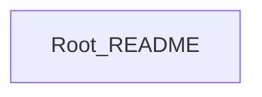

## Stack
- Not a code project. Repo root contains only `README.md` (single line: "# DeveOps") and `.git`.
- No manifest file (package.json, go.mod, pyproject.toml, Cargo.toml) found.
- No source directories, no entry points found.

## Directory map
| path | what lives there |
|---|---|
| / | `README.md` (title only) |
| /.git | git metadata |

## Diagram

## Component index
- [[Root_README]]

## Entry points
- Dev: none — TODO: verify
- Prod: none — TODO: verify

## Conventions
- None observed — repo has no code files to derive conventions from.

## Where things go
- To add a new component, first establish a manifest (package.json/go.mod/etc.) and directory structure — none exists yet.
- To document the project's purpose, expand `README.md`.
